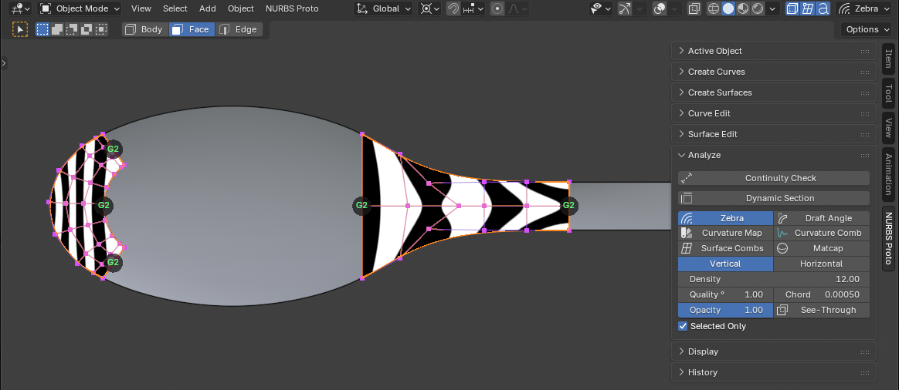

# NURBS Proto

**A Class-A NURBS surface modeling toolkit for Blender**, built on NVIDIA's open-source
[USD BRep](https://github.com/NVIDIA-Omniverse/usd-brep) kernel.

Explore a product idea, a concept form or a car body part with NURBS curves and
surfaces right in Blender, alongside SubD. Every surface is exact: check it with
zebra and curvature tools, then take it to your CAD app as STEP.

  

## Install

1. Download the zip for your system from [Releases](https://github.com/cekuhnen/blender-nurbs/releases):
   macOS (Apple Silicon), Windows (x64) or Linux (x64).
2. In Blender 5.0 or newer: **Edit → Preferences → Get Extensions**, the menu at the top right,
   **Install from Disk…**, and pick the zip.
3. In the 3D View, press **N** and open the **NURBS Proto** tab.

## The toolkit

The sidebar tab has one panel per area. The same tools are in the **NURBS Proto** header
menu and in **F3** search; the Create tools are also in **Add (Shift+A)**.

### Construction History

Features remember how they were built. Move a curve, change a setting or a cutter, and
everything built from it rebuilds.

- Live feature settings in the **Active Object** panel: continuity, weights, degree, spans
- History steps on top: Trim, Edge Fillet, Fillet Trim (edit, mute or remove each one)
- Construction Tree: what an object is built from, and what uses it
- Remove a feature to step back: its inputs return
- Pause Rebuild, Delete History, Collect Inputs

### Create Curves

- **Draw:** CV Curve, Draw Line (lines and tangent arcs), Arc, Circle, Ellipse, Rectangle (rounded corners), Polygon, Slot, Helix (3D: pitch, taper, left-handed), Profile
- **Between curves:** Blend Curve, Fillet (trims and joins)
- **Shapes:** in Shift+A every shape at the 3D cursor (sized to the view)
- **From surfaces:** Iso Curve, Duplicate Edge, Project Curve, Intersect
- **Snapping:** to curves, NURBS surfaces and meshes (vertex, edge, edge center, face center; **O** onto the face), smart guides (aligned, tangent, parallel, perpendicular), **Alt** for a free point, **Ctrl** for the grid

### Curve Edit

- Join Curves, Unjoin Curves, Trim Curves, Split Curves
- Rebuild Curve, Extend Curve, Align Curve

### Create Surfaces

- **Draw:** Draw Plane
- **Primitives:** Plane, Disk, Box, Cylinder, Cone, Sphere, Torus
- **From curves:** Loft, Loft Rails, Sweep, Pipe, Extrude, Revolve, Planar
- **Fill a gap:** Boundary, Square, Patch, Dome
- **From surfaces:** Offset, Thicken, Convert Blender Surface

### Surface Edit

- **Shape:** Edit CVs, Flip Normal, Rebuild Surface, Extend Surface, Surface Align, Refit to Trim
- **Trim and join:** Trim, Split, Untrim, Join, Unjoin
- **Fillets:** Surface Fillet, Edge Fillet
- **Solids:** Union, Difference, Intersection, Boundary Fill

### Analyze

- **Continuity Check:** G0, G1 and G2 between surfaces
- **Feature Labels:** each feature's edges show the continuity it holds, live; click one to change it
- **Overlays:** Zebra, Curvature Map, Draft Angle, Matcap
- **Combs and sections:** Curvature Comb, Surface Combs, Dynamic Section

### STEP Import and Export

Exchange exact geometry with your CAD app: **File → Import / Export → NURBS (.step)**.

- **Import:** AP203, AP214 and AP242 solids and surface models, as exact trimmed NURBS,
  with units and assembly placements converted
- **Export:** AP214 with exact B-spline surfaces and full B-rep topology; closed bodies
  as solids; in mm, cm or m

## Learn more

- [Tool Guide](docs/GUIDE.md): every tool in detail, by area
- [Development](docs/DEVELOPMENT.md): build the kernel, run the tests, package a release, known limits

## License

NURBS Proto is GPL-3.0-or-later. The USD BRep kernel is © NVIDIA, Apache-2.0.
