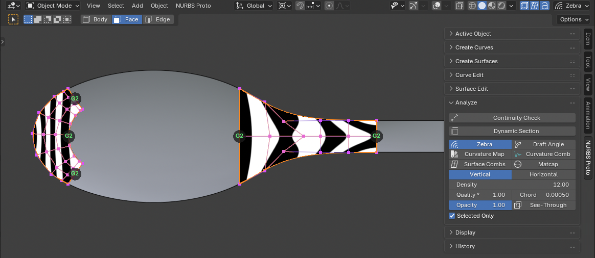

# NURBS Proto

**A Class-A NURBS surface modeling toolkit for Blender**, built on NVIDIA's open-source
[USD BRep](https://github.com/NVIDIA-Omniverse/usd-brep) kernel.

NURBS Proto is a research project: it brings Class-A NURBS surface modeling to Blender, together with ideas
from solid modeling (exact bodies, booleans, fillets and history that rebuilds). The experiment explores how
surface and solid modeling can flow together with mesh and SubD, moving freely between them, while still
feeling like modeling in Blender: its own selection, transform tools, snapping, Edit Mode and undo.

Explore a product idea, a concept form or a car body part with NURBS curves and
surfaces right in Blender, alongside SubD. Every surface is exact: check it with
zebra and curvature tools, then take it to your CAD app as STEP.

  

## Install

1. Download the zip for your system from [Releases](https://github.com/cekuhnen/blender-nurbs/releases):
   macOS (Apple Silicon), Windows (x64) or Linux (x64).
2. In Blender 5.0 or newer: **Edit → Preferences → Get Extensions**, the menu at the top right,
   **Install from Disk…**, and pick the zip.
3. In the 3D View, press **N** and open the **NURBS Proto** tab.

## The toolkit

The sidebar tab has one panel per area. The same tools are in the **NURBS Proto** header
menu and in **F3** search; the Create tools are also in **Add (Shift+A)**.

### Construction History

Features remember how they were built. Move a curve, change a setting or a cutter, and
everything built from it rebuilds.

- Live feature settings in the **Active Object** panel: continuity, weights, degree, spans
- History steps on top: Trim, Edge Fillet, Fillet Trim, Refit to Trim, Merge Patches (edit, mute or remove each one)
- Construction Tree: what an object is built from, and what uses it
- Remove a feature to step back: its inputs return
- Pause Rebuild, Delete History, Collect Inputs

### Create Curves

- **Draw:** CV Curve, Draw Line (lines and tangent arcs), Arc, Circle, Ellipse, Rectangle (rounded corners), Polygon, Slot, Helix (3D: pitch, taper, left-handed), Profile
- **Between curves:** Blend Curve, Fillet (trims and joins)
- **From curves:** Offset Curve (individual or joined; sharp, round or chamfered corners), Offset on Surface
  (curves or surface edges offset along the surface by a distance measured on it, across joined faces, cut at
  trims and free edges)
- **Shapes:** in Shift+A every shape at the 3D cursor (sized to the view)
- **From surfaces:** Iso Curve, Duplicate Edge, Project Curve, Intersect (Iso Curve and Duplicate Edge keep the
  surface's own CVs, degree, knots and weights: a cylinder rim is its exact 8-CV rational circle)
- **Snapping:** to curves, NURBS surfaces and meshes (vertex, edge, edge center, face center; **O** onto the face), smart guides (aligned, tangent, parallel, perpendicular), sketches flat on the face you start on or on the world grid, **Alt** for a free point, **Ctrl** for the grid (a finer floor grid in perspective, on / off under Display)

### Curve Edit

- Join Curves, Unjoin Curves, Trim Curves, Split Curves
- Rebuild Curve, Extend Curve, Align Curve

### Create Surfaces

- **Draw:** Plane, Box (corner to corner, centre to corner or 3 points, then the height; or diagonal, two corners in 3D), Cylinder (centre, radius, height, or around a circle or hole; exact or smooth, solid or
  open)
- **Primitives:** Plane, Disk, Box, Cylinder, Cone, Sphere, Torus
- **Through curves or edges:** Loft (G0 to G3 to surface edges), Loft Rails, Curve Network (a grid of crossing
  curves or edges, G0 / G1 / G2 to surface edges around it), Revolve, Rail Revolve (exact), Sweep, Pipe
- **Extrude and fill:** Extrude (curves or edges into walls; a face into a solid joined to its body, cut from it
  or new, with draft on flat faces), Flange (from free edges or curves on a surface: at an angle to the surface, or a
  constant-draft surface to a pull direction; the base is the edge exactly), Planar, Dome, Boundary, Patch
- **From surfaces:** Offset, Thicken, Pattern, Unroll, Flow, Convert Blender Surface
- **Unroll and Flow:** Unroll Surface lays developable surfaces flat (sheet-metal patterns: cones, cylinders,
  bent and folded sheets, joined parts with their bend lines; trims and curves on them come along); Flow Along
  Surface bends curves and surfaces from a base surface onto a target, and folds what is drawn on an unrolled
  pattern back onto its part exactly
- **Pattern:** one button for linear, circular and path patterns (**M** switches) of curves and NURBS objects: real copies with their exact
  geometry (not Blender's mesh-only Array), on a snapping widget: a row, grid or block along its X / Y / Z (turned
  to any angle), around its axis, or along a curve or edge; number keys set the count; with history the copies
  follow their source and path

### Surface Edit

- **Shape:** Edit CVs (Tab switches between Object and CV editing), Flip Normal, Rebuild Surface, Extend Surface,
  Surface Align, Refit to Trim
- **Merge Patches:** a four-sided grid of patches rebuilt as one surface. **Exact** joins them with full seam knots,
  **Reduce** removes knots within a tolerance, **Refit** finds the fewest spans of a chosen degree, with adaptive
  knots placed where the shape needs them. The outer edges hold Free, G0, G1 or G2 (all sides or each side), so
  continuity to the neighbours carries over; seams where the patches meet with a kink stay sharp (or Smooth).
  Gap, angle and curvature checks show in the panel; trimmed patches fall back to a projected grid (G0 edges)
- **Trim and join:** Trim, Split, Untrim, Join, Unjoin
- **Fillets:** Surface Fillet, Edge Fillet (circular, chamfer, or blends G1 to G3)
- **Solids:** Union, Difference, Intersection, Boundary Fill

### Analyze

- **Measure:** distance between snapped points (with ΔX ΔY ΔZ), radius and diameter of circles, curves, edges and
  surfaces (exact for true circles, else the radius of curvature; a face's two principal radii)
- **Continuity Check:** G0, G1, G2 and G3 between surfaces
- **Feature Labels:** each feature's edges show the continuity it holds, live; click one to change it
- **Overlays:** Zebra, Curvature Map, Draft Angle, Matcap, Scan Deviation (distance from a scan mesh)
- **Combs and sections:** Curvature Comb, Surface Combs, Dynamic Section
- **Display:** Edges, CVs / Hulls (surfaces, and selected curves outside Edit mode), Spans (every face's knot
  lines, clipped to its trims), Feature Labels, Fine Grid

### Convert

- **BREP to Mesh:** plain meshes for rendering, texturing and animation, at Low, Medium or High detail:
  n-gons on flat faces and quads on curved ones (or all triangles), welded, with sharp creases, UVs and seams
- **Mesh to BREP:** mesh bodies rebuilt as NURBS bodies: flat four-sided faces as untrimmed patches, other flat faces
  as planes cut tight to their trims, round holes and cylinders exact (also a hole cut through an edge or corner),
  bevels (Profile 0.5) as G1 fillets of the bevel's radius, editable afterwards, boxy bevels (Profile above 0.5) as
  exact G2 superellipse strips, mitred where two meet; boxy corners and swept bevels as G1 free-form patches
- **SubD to BREP:** Subdivision Surface models as NURBS bodies with one face per cage face: one bicubic span (the
  SubD surface exactly) wherever the cage is regular, and at star points faces of 2 x 2 pieces with even nets
  (G2: degree 6, 12 x 12; G1: degree 5, 10 x 10), solved so every face joins exactly (Continuity Check: G1 0.000°,
  G2 0.00 %, star points included), creases as sharp edges, open borders with or without kept corners; triangles and n-gons split into quads that meet the
  cage quads beside them at exact T-junctions
- **Fit to Scan:** fit a SubD cage so its smooth surface (not its vertices, as a Shrinkwrap would) lies on a scan,
  a set offset off it, or draped over it (bridging folds, never dipping in: housings, covers, sockets), then SubD to
  BREP makes the exact NURBS body (the **Scan** panel). **Cage from Scan** builds and fits a starting cage for
  limb-like scans; **Fit Cage to Scan** fits any SubD cage, its **Add Loops** cutting edge loops only where the
  surface misses the scan (all quads, no new star points), and a selected curve becoming the trim line its open
  edge is held to; **Drape Patch to Scan** lays
  one single-span NURBS patch (degree 5 from a 6 × 6 grid) straight down onto a scan, its CVs moving only up and
  down, its edges G0 / G1 / G2 to the neighbouring patches (exact where their edges are one span); the
  **Scan Deviation** overlay colours any surface by its distance from the scan

### STEP Import and Export

Exchange exact geometry with your CAD app: **File → Import / Export → NURBS (.step)**.

- **Import:** AP203, AP214 and AP242 solids and surface models, as exact trimmed NURBS,
  with units and assembly placements converted
- **Export:** AP214 with exact B-spline surfaces and full B-rep topology; true planes,
  cylinders, cones, spheres, tori, revolutions, extrusions, offsets, circles, ellipses and lines as STEP's own analytic entities; closed bodies as solids; in
  mm, cm or m

## Learn more

- [Tool Guide](docs/GUIDE.md): every tool in detail, by area
- [Development](docs/DEVELOPMENT.md): build the kernel, run the tests, package a release, known limits

## Creator

NURBS Proto is designed and built by industrial designer and design faculty **Claas Kuhnen** ([LinkedIn](https://www.linkedin.com/in/claaskuhnen/) · [GitHub](https://github.com/cekuhnen)), with Claude as a coding
partner. Ideas, bug reports and models that break it are welcome in
[Issues](https://github.com/cekuhnen/blender-nurbs/issues).

## License

NURBS Proto is GPL-3.0-or-later. The USD BRep kernel is © NVIDIA, Apache-2.0.
